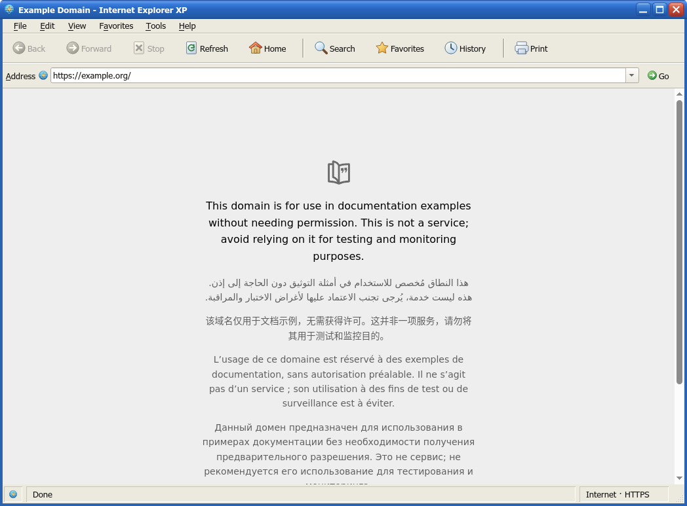

# Internet Explorer XP

A native KDE web browser with compact XP-era controls, original artwork, and Qt WebEngine's Chromium renderer. The default is one page per window. Enable tabs in Tools → Internet Options → Advanced for new windows.

## Build and install on Bazzite

The preferred install is a user-scoped Flatpak. The package pairs the KDE 6.11 runtime with the Qt WebEngine 6.11 BaseApp. Update and rebuild against the current maintained pairing before distributing a browser build.

```sh
flatpak remote-add --user --if-not-exists flathub https://flathub.org/repo/flathub.flatpakrepo
flatpak install --user flathub org.flatpak.Builder
./scripts/package.sh
flatpak install --user ./io.github.Mschmitt478.ChromiumExplorer.flatpak
flatpak run io.github.Mschmitt478.ChromiumExplorer https://example.org/
```

The runner supports Wayland and falls back to X11. KDE owns the title bar and frame. The package uses file dialogs to request access to selected files and download destinations. Use KDE System Settings → Default Applications to register the Flatpak as the browser.

For development, run these commands in a Fedora Distrobox. CMake and Ninja drive the C++20 build. Qt Widgets supplies the UI, Qt Print Support handles printing, Qt Network handles local URL dispatch, and Qt SQL uses SQLite.

```sh
sudo dnf install gcc-c++ cmake ninja-build qt6-qtbase-devel qt6-qtwebengine-devel cups-devel
./scripts/test.sh
./scripts/run.sh https://example.org/
```

For a development launch using XWayland, run `QT_QPA_PLATFORM=xcb ./scripts/run.sh` on a Plasma Wayland session.

## Browser extensions

Open **Tools → Extensions → Install Folder** and select a publisher-provided Manifest V3 extension folder containing `manifest.json`. If you received a ZIP, extract it first. Installed extensions start disabled. Select an extension to enable, disable, open its popup when available, or remove it. The normal profile remembers enabled extensions across restarts. Private windows use a separate profile without those extensions.

Extension compatibility depends on the APIs provided by Qt WebEngine. Installation uses local files. Chrome Web Store one-click installation and automatic store updates are unavailable.

## Keyboard shortcuts

| Shortcut | Action |
|---|---|
| Alt+Left / Alt+Right | Back / Forward |
| Alt+D / Ctrl+L | Address |
| F5 / Ctrl+R | Refresh |
| Ctrl+F5 | Refresh bypassing cache |
| Esc | Stop |
| Alt+Home | Home |
| Ctrl+D | Add to Favorites |
| Ctrl+I / Ctrl+H | Favorites / History |
| Ctrl+F | Find |
| Ctrl+N / Ctrl+W | New window / Close tab or window |
| Ctrl+T | New tab in tab mode |
| Ctrl+P | Print |
| Ctrl+Plus / Ctrl+Minus / Ctrl+0 | Zoom in / out / reset |
| F11 | Full screen |



[Architecture and limitations](docs/architecture.md) · [Validation](docs/validation.md) · [Desktop Chromium capability audit](docs/chromium-parity.md)
